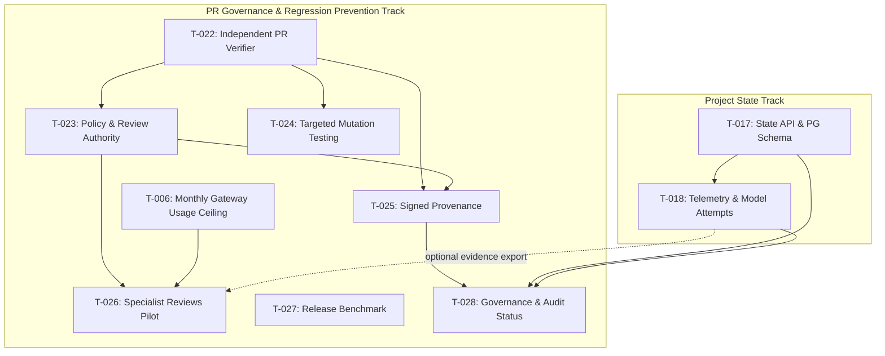

# PR governance and regression prevention low-level design

**Status** Proposed. The kit currently ships a local test-edit guard, isolated QA worktrees, and a decision gate that binds local receipts to the diff and config. The two repos run CI. The independent verifier, required merge check, signed CI attestations, jury and release benchmark are implementation work.

## Ownership and rollout

| Component | Owner | Responsibility |
|---|---|---|
| Local preflight and reusable verifier | god-of-code-kit | Package the preflight for installable repos. Provide a verifier, evidence format and sample policy for GitHub CI. |
| Repository policy and merge control | Each consuming repo | Protect the base branch, designate human owners, pin the trusted verifier identity and set allowed exception rules. |
| Review routing and release benchmark | limpid-ai-dev-stack | Route permitted reviewer calls through LiteLLM, enforce budgets and compare changes to a frozen baseline. |
| Audit history and reporting | Project State Service | Store signed decisions and approved metadata. Keep audit history available when inference moves. |
| Operations and notifications | LiteLLM and WSL supervisor | Display model cost, usage and latency through LiteLLM. Send status and PR links through the existing Slack adapter after personal setup is verified. |

Pilot local preflight and the verifier in the public kit before activating any required rule. The GitHub API reported an unprotected main in both repos and rejected ruleset access on the private infra repo under its current plan. Keep infra private.

**Operational Reality & The CI Gap**: In `limpid-ai-dev-stack`, `.github/workflows/ci.yml` gates execution behind `if: ${{ !github.event.repository.private }}` to avoid consuming metered hosted runner minutes. As a consequence, GitHub Actions skips every run entirely on private repositories (`gh pr checks 11` reports skipped). CI in practice does *not* run on GitHub—not even in report-only mode. Verification only occurs if a maintainer manually executes the test suite locally in WSL. This operational reality is precisely how the `--host 0.0.0.0` test failure in PR #11 merged onto `main` undetected. This blindspot is the single strongest argument for the governance work. Until T-023 provides native server-side or hosted enforcement, the private repo relies on a mandatory local pre-merge check and git hook in WSL (`scripts/pre_merge_check.sh`). Native merge enforcement requires a supporting plan or Git host. For personal use, choose a setup that preserves independent human ownership. If GitHub requires a review that the sole owner cannot give on their own PR, keep the verifier advisory for that workflow until an eligible independent reviewer is available.

## Governance dependency graph

## Preflight and independent verification

1. The WSL worker publishes a change plus acceptance IDs, test evidence and the existing local decision receipt. The QA worker tests the exact revision in a separate worktree. The local result can speed up review and is treated as caller-supplied evidence, not enforcement.
2. A trusted verifier fetches GitHub's immutable PR base/head SHAs, computes the merge base and reads the change itself. It loads policy, tool versions, protected paths and the expected checks from a trusted revision. Use a separate verifier identity. Its signing and check-writing permissions stay outside jobs that execute PR code.
3. Run standard tests, types and lint. Evaluate changed, deleted, renamed or disabled tests against the approved baseline. Require explicit human approval for intentional changes to test invariants. Resolve acceptance IDs to executed test results or an explicitly approved manual check. A matching test name without executed evidence is insufficient.
4. Use a pinned oasdiff CLI for repos with OpenAPI. Compare the trusted baseline to the candidate schema and require an approved migration decision for breaking changes. Add contract execution against synthetic services where applicable. Repos with other contract formats use an explicit adapter. Repos without contracts record that the check is inapplicable.
5. An OPA policy consumes normalized diff and review data. Require human approvals for flagged dependency changes, auth, crypto, migrations, CI, governance policy and verifier configuration. Authorize exceptions by repository, current head, rule ID, identity and reason. Verify the approval from GitHub's trusted review data. Use test-to-code ratios as advisory signals and use coverage of actual acceptance behavior for enforcement.
6. The verifier writes the result for the exact PR head to limpid/governance-passed. A new head, relevant base change or policy revision triggers reevaluation and stales affected evidence. Evaluate changes to the verifier itself under the existing trusted version. If merge queues are adopted, also verify the merge-group revision.

In the target architecture, run untrusted PR tests on disposable runners with read-only repository access and without signing, cloud, model or deployment credentials (implementation target for T-022/T-023). Treat diffs, test output and manifests as input data when privileged jobs handle them. The trusted finalizer independently checks job identities, revisions and integrity before publishing a conclusion. Protect the verifier and policy from the worker, including its GitHub token, workflow permissions and branch bypass access. Bind the required check to the expected verifier app where supported.

## Mutation testing and specialist review

- Run changed-code mutation tests in the QA scratch worktree using a language adapter such as mutmut, cargo-mutants or Stryker. Time-box the run and record killed, survived, timed-out and excluded mutants. Start advisory and require resolution of meaningful survivors on selected high-risk code once false positives are measured. Equivalent mutants need a recorded rationale. A timeout means the result is incomplete.
- Run security, architecture/performance and QA reviewers in parallel on approved, minimized inputs through LiteLLM. Choose model aliases through policy and measure outcome quality before expanding coverage. Keep model calls outside the deterministic PR check path. For repositories opting into the jury, a high-severity security claim opens a blocking item for a human owner. The owner resolves it with a fix or a documented risk decision for the current revision. A missing or malformed review records an unavailable verdict and follows the repo's explicit policy for required review.
- The jury has read-only access to its evidence and produces findings with rule, severity, confidence, file location and rationale. A juror cannot approve a PR, modify policies or publish the authoritative check. Route only payloads allowed by project privacy rules. Cap concurrency, tokens and spend across reviewers. Budget ceilings require T-006 to be enforced in the gateway before asynchronous specialist reviews can be safely run. A cheaper fallback must satisfy the same data policy.

## Provenance and audit

Issue one versioned attestation envelope per verifier run. The signed subject binds repository, PR number, base, merge base, head and a canonical changed-content digest that covers paths, modes and blob IDs in stable order. The predicate includes the policy digest, verifier version, executed test and contract outcomes, evidence artifact digests, exception identities and reasons, and reviewer outcomes when applicable. Include model ID, routing decision ID, approved template digest, token totals and cost when available. Record unavailable totals as null.

The trusted verifier signs the canonical envelope using a dedicated key or verified workload identity. Store the envelope outside the PR tree so its subject can refer to the final commit. Validate the signer, repository, current revisions, applicable policy and artifact digests before accepting it. Append supplemental human decisions with their own identity and revision binding. Keep raw prompts, source, credentials and detailed private evidence in access-controlled storage. Keep public attestations limited to metadata approved for public release.

Store the minimum signed record and hashes as verifier artifacts first. Once the [Project State Service](project-state-lld.md) exists, persist signed evidence there under the project ID and join on run and model-attempt IDs. State keeps the audit trail and GitHub holds merge authority. A temporary state outage is surfaced in delivery status and buffered without letting the worker attest to its own work. Show check outcome and evidence links through GitHub and the state dashboard. LiteLLM continues to show inference cost and performance. Port.io is an optional read-only export for later multi-repo reporting.

## Promotion benchmark

Maintain a frozen set of 5 to 10 representative coding tasks with known edge cases and hidden acceptance checks. Compare the same baseline and candidate with the same task inputs and resource limits. Measure completed acceptance criteria, tasks passed, rework, token and monetary usage, and elapsed time. Block promotion on a confirmed new high-severity security finding or a pass-rate drop greater than five percentage points. With a small corpus, inspect every changed outcome and repeat noisy cases. Save task, model, prompt and tool versions so results can be reproduced. Begin with synthetic or approved data.

## Acceptance checks

- A normal PR passes. A revision change, test weakening or contract break without authorized approval, and a forged or stale attestation each fail.
- A PR that edits CI, changes policy or writes its own fake results cannot change the effective verifier or satisfy the required check. A human-approved breaking change carries a migration decision for the exact revision.
- An authorized maintainer sets up the ruleset on a test repository and verifies that a failing or missing check blocks merge. The private infra report remains visibly advisory until enforcement is supported and verified.
- The QA pilot detects a meaningful surviving mutant and reports an intentionally time-boxed run as incomplete. The review pilot proves its high-severity and unavailable paths with synthetic findings.
- A benchmark candidate with a known regression fails promotion. Signed evidence remains verifiable after exporting it to another state host.

## References

- [Project task board](tasks.md)
- [GitHub ruleset availability](https://docs.github.com/en/repositories/configuring-branches-and-merges-in-your-repository/managing-rulesets/about-rulesets)
- [GitHub Actions security guidance](https://docs.github.com/en/actions/reference/security/securely-using-pull_request_target)
- [OpenAPI breaking-change checks](https://github.com/oasdiff/oasdiff/blob/main/docs/BREAKING-CHANGES.md)
- [Open Policy Agent documentation](https://www.openpolicyagent.org/docs/)
- [GitHub artifact attestation documentation](https://docs.github.com/en/actions/concepts/security/artifact-attestations)
