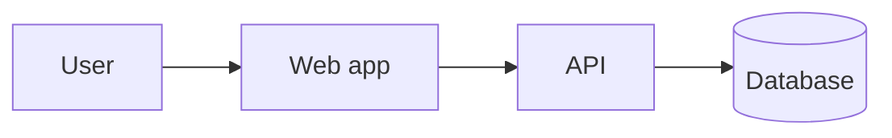

# Architecture (high level)

- **Stack**: languages, frameworks, versions
- **Components / services**: name → responsibility → repo path
- **Data stores**: DB, cache, queues, object storage
- **External integrations**: payment gateways, ERP/finance, email/SMS, auth providers
- **Runtime / hosting**: containers, orchestration, cloud services
- **Cross-cutting**: auth, logging, monitoring, feature flags

Low-level details belong in `lld.md`.
